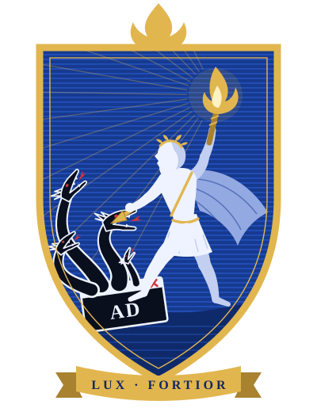

# Чисто — личный блокировщик рекламы

*Война с рекламой вечна. Свет сильнее.*

**Поставить: [chisto.flownote.cc](https://chisto.flownote.cc)**

Одна страница, одна кнопка на устройство. Человек открывает сайт, нажимает кнопку своей платформы,
подтверждает системный диалог — рекламные домены режутся, обычные сайты открываются.

Это **не** одна программа на все ОС (так честно не бывает). Это один бренд и одна ссылка:

| Устройство | Что ставится | Как |
|---|---|---|
| iPhone / iPad | Профиль DNS-over-HTTPS | Скачать → Настройки → Установить → код-пароль → ещё раз Установить → выбрать DNS. Пароль неизбежен |
| iPhone (позже) | Приложение DNS Settings + блокировщик Safari | Только TestFlight / App Store, нужен аккаунт Apple $99/год |
| Android | «Частный DNS», приложение (локальный VPN только для DNS) или «Безопасный DNS» в Chrome | APK с сайта или Play |
| Компьютер | Расширение MV3 (Chrome-семейство и Firefox) + по желанию DNS | Магазин или «Загрузить распакованное» |
| Роутер | DoH/DoT на роутере | Вся домашняя сеть без установки |
| Telegram | Бот: те же кнопки, расширение файлом, «поделиться» в любом чате | `/start` |

Сколько действий: iPhone — 4 касания и код-пароль; Android и Chrome — скопировать адрес и 3 касания; расширение — 1 клик из магазина или 3 шага из архива.

Стены «отключите блокировщик» снимаются сетью и CSS: детекторы (BlockAdBlock и клоны) не загружаются, плюс ежедневный список Adblock Warning Removal, RU AdList и русский фильтр AdGuard.

Что убирается, а что нет — честно в [docs/LIMITS.md](docs/LIMITS.md). Коротко: сайты в браузере — основной эффект;
приложения — режутся отдельные рекламные домены; официальные YouTube/TikTok/Instagram — **не поддерживаются**.

## Два варианта сервера

| | Cloudflare Worker | VPS + Docker |
|---|---|---|
| Цена | Бесплатно, без карты | VPS (обычно платный) + домен |
| DoH (iPhone, Chrome, Windows, приложение Android) | да | да |
| DoT (Android «Частный DNS», часть роутеров) | **нет** | да |
| Защита от CNAME-маскировки | да | да (AdGuard Home) |
| Обновление списков | при деплое | само, раз в сутки |
| Сколько людей | ~10–20 телефонов (100 000 запросов/сутки) | сотни |

## Быстрый старт: Cloudflare (бесплатно)

    cp .env.example .env              # DOH_HOST=свой поддомен в Cloudflare (или *.workers.dev), SERVER_IP= пусто
    scripts/setup-cloudflare.sh       # правила, профиль iOS, сайт
    cd cloudflare && npx wrangler deploy
    node ../scripts/check-doh.mjs     # проверка: реклама blocked, обычные сайты resolves

Свой домен: поменяйте `routes` в `cloudflare/wrangler.jsonc`. Важно: `custom_domain` забирает адрес у другого воркера, если он уже занят, — проверьте, что поддомен свободен.

Telegram-бот (по желанию): создайте бота в @BotFather, положите токен в `cloudflare/.tg-token`, впишите имя в `.env` → `TG_BOT` и запустите `scripts/setup-telegram.sh`. Бот живёт в том же Worker (`/tg`) и ничего не хранит.

## Быстрый старт: VPS за вечер

Нужно: VPS с Docker, домен с A-записью `DOH_HOST → SERVER_IP`, открытые порты 80, 443, 853.

    cp .env.example .env              # впишите DOH_HOST, SERVER_IP, ACME_EMAIL
    scripts/setup.sh                  # пароль панели, конфиг AdGuard Home, правила, профиль, сайт
    cd server && docker compose up -d
    node ../scripts/check-doh.mjs

После `docker compose up -d` работает:
- `https://DOH_HOST/` — сайт с кнопками и статусом «Фильтр жив»;
- `https://DOH_HOST/dns-query` — DoH, `DOH_HOST:853` — DoT;
- AdGuard Home со списками AdGuard DNS filter + StevenBlack + `filters/custom.txt`, автообновление раз в 24 ч;
- сертификат Let's Encrypt (Caddy), перезапуск DoT при продлении;
- `https://DOH_HOST/rules/update.json` — свежие правила для расширений.

Панель AdGuard Home в интернет не торчит: порт 3000 только на 127.0.0.1.

    ssh -L 3000:127.0.0.1:3000 user@SERVER_IP    # затем http://127.0.0.1:3000
    cat server/.admin-password                    # пароль сгенерирован setup.sh

## Что в репозитории

    .env.example              — DOH_HOST, DOH_PATH, SERVER_IP и др. Секретов в репозитории нет
    server/                   — docker-compose (AdGuard Home + Caddy), шаблон AdGuardHome.yaml, Caddyfile
    cloudflare/               — бесплатный вариант: Worker = DoH-фильтр + сайт + Telegram-бот; тесты
    filters/custom.txt        — свои правила (≈50 примеров всех типов), README — как добавить и откатить
    filters/shared-cdn.txt    — общие CDN, которые нельзя резать в DNS
    tools/build.mjs           — одна сборка: DNS, расширение, Safari, обновления; tools/rules.mjs — конвертер
    site/                     — страница установки (без регистрации), fixtures/ad.html — тест расширения
    ios-profile/              — install.mobileconfig генерируется scripts/gen-mobileconfig.sh из .env
    ios-app/                  — Xcode-проект: DNS Settings + Safari Content Blocker
    android-app/              — Gradle-проект: одна кнопка, локальный VPN только для DNS
    extension/                — исходники MV3, сборка под Chrome и Firefox
    scripts/                  — setup, генераторы, check-doh.mjs, audit-secrets.sh
    docs/                     — LIMITS, PRIVACY, ROUTER, ИСТОЧНИКИ (шрифты)
    tools/crest.mjs           — герб (site/crest.svg), tools/icons.sh — иконки из знака site/favicon.svg

## Проверка

`node scripts/check-doh.mjs` — сверяет ответы сервера с публичным DNS. Тесты Worker: `cd cloudflare && node --test test.mjs`. Ключей и паролей в репозитории нет: `scripts/audit-secrets.sh`.

Если правило слишком широкое и режет нормальный сайт — сужайте его ([filters/README.md](filters/README.md)), не «усиливайте блокировку».

## Поддержать

Чисто бесплатное и таким останется. Если хочется сказать спасибо — [DONATE.md](DONATE.md).

## Лицензия

MIT — см. [LICENSE](LICENSE). Списки фильтров (EasyList, RU AdList, AdGuard, StevenBlack) скачиваются при сборке и распространяются по своим лицензиям.

Сделал Прометей — бесплатно и от души. Сайты у нас тоже без рекламы: [глянуть](https://ksd.flownote.cc).
