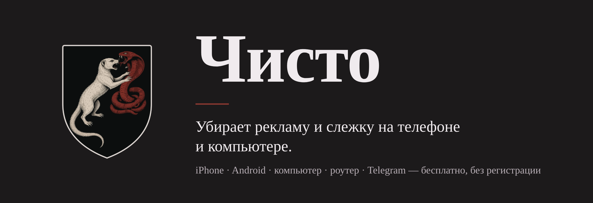
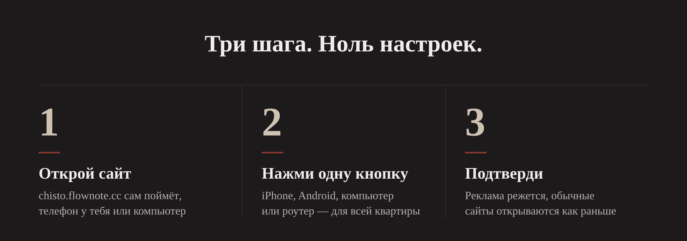
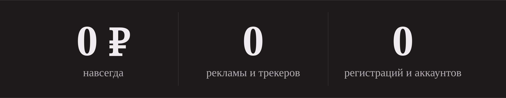
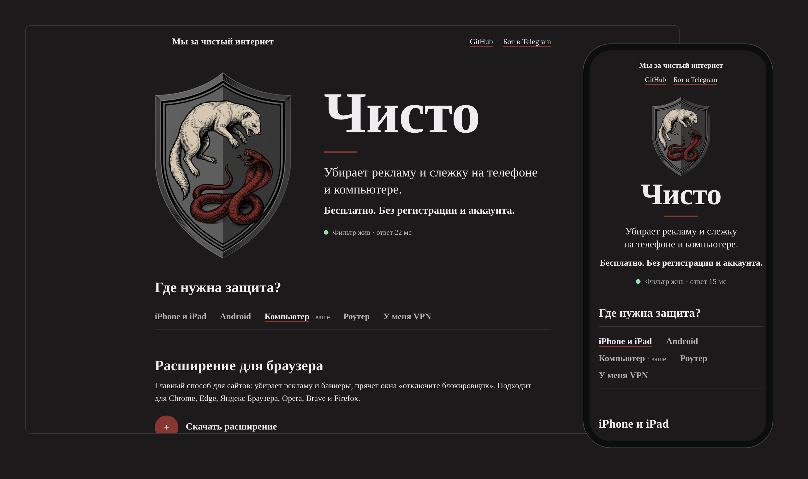
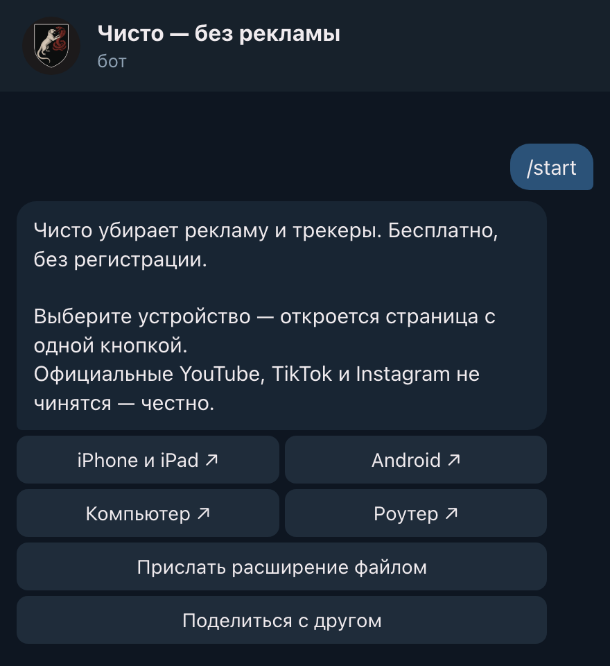

  

  
  
  
  
  
  

<h3 align="center">Открыл сайт, нажал одну кнопку — реклама пропала.</h3>

  Сайты, игры на телефоне, баннеры и слежка. Без регистрации, без аккаунта, без программ, которые висят в фоне. Бесплатно.

  <a href="https://chisto.flownote.cc"><b>Поставить: chisto.flownote.cc</b></a>
  &nbsp;·&nbsp;
  <a href="https://t.me/chisto_ads_bot"><b>Бот в Telegram</b></a>
  &nbsp;·&nbsp;
  <a href="#что-режется">Что режется</a>
  &nbsp;·&nbsp;
  <a href="#два-варианта-сервера">Свой сервер</a>
  &nbsp;·&nbsp;
  <a href="#поддержать">Поддержать</a>

 

  

  

## Почему этому можно доверять

Блокировщик стоит между вами и интернетом, поэтому доверие надо заслужить, а не попросить.

- **Сервер видит только имена сайтов.** Через него идёт DNS, а не ваш трафик: страницы, пароли и переписка идут напрямую. Журналов сервер не пишет.
- **Ничего личного не собираем.** Ни аккаунтов, ни журналов, ни доменов и адресов — только общие счётчики по дням ([docs/PRIVACY.md](docs/PRIVACY.md)).
- **Весь код открыт**, а архивы расширения в [релизах](https://github.com/kozliq/chisto/releases) собирает GitHub с подтверждением происхождения — можно проверить, что файл собран из этого кода.
- **Даже если сервер угонят**, расширение не примет от него ничего опасного: только «заблокировать» и «разрешить».
- **Тесты на каждое изменение** и проверка живого сервера каждые 6 часов.
- **Выключается в два касания** — инструкции в [SECURITY.md](SECURITY.md#как-выключить). Там же — куда писать, если нашли дыру.

## Установка

Одна страница, одна кнопка на устройство. Сайт сам понимает, телефон у тебя или компьютер, и показывает нужную кнопку.
Подтверждаешь системный диалог — рекламные домены режутся, обычные сайты открываются.

  

Это **не** одна программа на все системы (так честно не бывает). Это один бренд и одна ссылка:

| Устройство | Что ставится | Как |
|---|---|---|
| iPhone / iPad | Профиль DNS-over-HTTPS | Скачать → Настройки → Установить → код-пароль → ещё раз Установить → выбрать DNS. Пароль неизбежен |
| iPhone (позже) | Приложение DNS Settings + блокировщик Safari | Только TestFlight / App Store, нужен аккаунт Apple $99/год |
| Android | «Частный DNS» на весь телефон (`chisto-dot.flownote.cc`) или «Безопасный DNS» в Chrome | Скопировать адрес → 3 касания в настройках |
| Компьютер | Расширение MV3 (Chrome-семейство и Firefox) + по желанию DNS | Архив с сайта или файлом в боте → «Загрузить распакованное» (в магазинах — позже) |
| С VPN | DNS-адрес и список доменов прямо в VPN-клиенте | Вкладка «У меня VPN»: Shadowrocket, sing-box, Happ, V2Ray/Xray, Clash |
| Роутер | DoH на роутере | Вся домашняя сеть без установки |
| Telegram | Бот [@chisto_ads_bot](https://t.me/chisto_ads_bot): те же кнопки, расширение файлом, «поделиться» в любом чате | `/start` |

Сколько действий: iPhone — 4 касания и код-пароль; Android и Chrome — скопировать адрес и 3 касания; расширение — 3 шага из архива (в магазинах пока нет).

Стены «отключите блокировщик» снимаются сетью и CSS: детекторы (BlockAdBlock и клоны) не загружаются, плюс список Adblock Warning Removal (на момент сборки), RU AdList и русский фильтр AdGuard.

## Что режется

| Где | Что будет |
|---|---|
| Сайты в браузере | Баннеры, всплывашки, стены «отключите блокировщик» — основной эффект |
| Игры на телефоне | Unity Ads, AppLovin, ironSource, Vungle, Mintegral, AdMob — реклама в большинстве игр не грузится. Минус: «посмотри рекламу за бонус» тоже перестаёт работать |
| Реклама блогеров на YouTube | Расширение проматывает интеграции само: посреди ролика — сразу, а если ролик начинается с рекламы, она не показывается вовсе. Источники: база SponsorBlock, таймкоды в описании, своя отметка |
| SoundCloud | Рекламный сервер `promoted.soundcloud.com` закрыт |
| Spotify | **Нет.** Аудиореклама идёт с тех же серверов, что и музыка: закроешь их — сломается музыка. Режутся только пиксели слежки |
| YouTube, TikTok, Instagram (официальные приложения) | **Нет** — та же причина |

### VPN и блокировщик вместе

Почти у всех сейчас постоянно включён VPN, и обычный DNS-профиль с ним спорит: туннель забирает DNS себе. Поэтому «Чисто» не воюет с VPN, а встраивается в него. На сайте во вкладке «Использую VPN» — DNS-адрес и готовый список доменов для Shadowrocket, sing-box, Happ, V2Ray/Xray и Clash. Расширение в браузере работает поверх как обычно.

### Бот в Telegram

Ничего ставить не нужно: открой **[@chisto_ads_bot](https://t.me/chisto_ads_bot)** и нажми «Запустить». Те же кнопки, что на сайте, расширение файлом и «поделиться» в любом чате.

  

Что убирается, а что нет — подробно и честно в [docs/LIMITS.md](docs/LIMITS.md). Коротко: сайты в браузере — основной эффект;
приложения — режутся отдельные рекламные домены; официальные приложения YouTube/TikTok/Instagram — **не поддерживаются**.

**Реклама внутри роликов YouTube** (интеграции блогеров: банки, маркетплейсы, «промокод в описании») — расширение
пропускает её само, если вставка есть в открытой базе [SponsorBlock](https://sponsor.ajay.app) (CC BY-NC-SA 4.0)
или отмечена таймкодом в описании. Нет в базе — «Отметить рекламу» в углу плеера: у вас пропускается сразу,
а по кнопке уходит в SponsorBlock и пропускается у всех. В базу уходят только 4 символа хеша id ролика.
Работает в браузере на компьютере; в приложении YouTube на телефоне — нет.

## Два варианта сервера

| | Cloudflare Worker | Свой сервер + Deno ([server/deno](server/deno)) | VPS + Docker |
|---|---|---|---|
| Цена | Бесплатно, без карты | VPS | VPS (обычно платный) + домен |
| DoH (iPhone, Chrome, Windows, приложение Android) | да | да, через Cloudflare Tunnel | да |
| DoT (Android «Частный DNS», часть роутеров) | **нет** | **нет** | да |
| Защита от CNAME-маскировки | да | да (тот же код) | да (AdGuard Home) |
| Обновление списков | при деплое | при выкладке | само, раз в сутки |
| Сколько людей | несколько десятков телефонов (100 000 запросов/сутки) | тысячи (4 400 запросов/с на 1 ядре, с кэшем) | сотни |

Официальный «Чисто» так и устроен: сайт и бот — на Worker, DNS для телефонов — на своём сервере (`chisto-dns.flownote.cc`), а «Частный DNS» для Android (DoT, порт 853) — на отдельном сервере `chisto-dot.flownote.cc` (`cloudflare/src/dot.js`, служба `server/deno/chisto-dot.service`).

## Быстрый старт: Cloudflare (бесплатно)

    cp .env.example .env              # DOH_HOST=свой поддомен в Cloudflare (или *.workers.dev), SERVER_IP= пусто
    scripts/setup-cloudflare.sh       # правила, профиль iOS, сайт
    cd cloudflare && npx wrangler deploy
    node ../scripts/check-doh.mjs     # проверка: реклама blocked, обычные сайты resolves

Свой домен: поменяйте `routes` в `cloudflare/wrangler.jsonc`. Важно: `custom_domain` забирает адрес у другого воркера, если он уже занят, — проверьте, что поддомен свободен.

Telegram-бот (по желанию): создайте бота в @BotFather, положите токен в `cloudflare/.tg-token`, впишите имя в `.env` → `TG_BOT` и запустите `scripts/setup-telegram.sh`. Бот живёт в том же Worker (`/tg`) и ничего не хранит.

## Быстрый старт: VPS за вечер

Нужно: VPS с Docker, домен с A-записью `DOH_HOST → SERVER_IP`, открытые порты 80, 443, 853.

    cp .env.example .env              # впишите DOH_HOST, SERVER_IP, ACME_EMAIL
    scripts/setup.sh                  # пароль панели, конфиг AdGuard Home, правила, профиль, сайт
    cd server && docker compose up -d
    node ../scripts/check-doh.mjs

После `docker compose up -d` работает:
- `https://DOH_HOST/` — сайт с кнопками и статусом «Фильтр жив»;
- `https://DOH_HOST/dns-query` — DoH, `DOH_HOST:853` — DoT;
- AdGuard Home со списками AdGuard DNS filter + StevenBlack + `filters/custom.txt`, автообновление раз в 24 ч;
- сертификат Let's Encrypt (Caddy), перезапуск DoT при продлении;
- `https://DOH_HOST/rules/update.json` — свежие правила для расширений.

Панель AdGuard Home в интернет не торчит: порт 3000 только на 127.0.0.1.

    ssh -L 3000:127.0.0.1:3000 user@SERVER_IP    # затем http://127.0.0.1:3000
    cat server/.admin-password                    # пароль сгенерирован setup.sh

## Что в репозитории

    .env.example              — DOH_HOST, DOH_PATH, SERVER_IP и др. Секретов в репозитории нет
    server/                   — docker-compose (AdGuard Home + Caddy), шаблон AdGuardHome.yaml, Caddyfile
    cloudflare/               — бесплатный вариант: Worker = DoH-фильтр + сайт + Telegram-бот; тесты
    server/deno/              — тот же DNS-фильтр на своём сервере: Deno + Cloudflare Tunnel + сторож
    filters/custom.txt        — свои правила (≈50 примеров всех типов), README — как добавить и откатить
    filters/shared-cdn.txt    — общие CDN, которые нельзя резать в DNS
    tools/build.mjs           — одна сборка: DNS, расширение, Safari, обновления; tools/rules.mjs — конвертер
    site/                     — страница установки (без регистрации), fixtures/ad.html — тест расширения
    ios-profile/              — install.mobileconfig генерируется scripts/gen-mobileconfig.sh из .env
    ios-app/                  — Xcode-проект: DNS Settings + Safari Content Blocker
    android-app/              — Gradle-проект: одна кнопка, локальный VPN только для DNS
    extension/                — исходники MV3, сборка под Chrome и Firefox
    scripts/                  — setup, генераторы, check-doh.mjs, audit-secrets.sh
    docs/                     — LIMITS, PRIVACY, ROUTER, ИСТОЧНИКИ (шрифты)
    brand/kit/                — фирменный стиль: герб (мангуст против кобры), цвета, шрифт — BRAND.md
    tools/readme-assets.sh    — картинки README из .github/assets/src/*.html (headless Chrome)

## Проверка

`node scripts/check-doh.mjs` — сверяет ответы сервера с публичным DNS. Тесты Worker: `cd cloudflare && node --test test.mjs`. Ключей и паролей в репозитории нет: `scripts/audit-secrets.sh`.

Если правило слишком широкое и режет нормальный сайт — сужайте его ([filters/README.md](filters/README.md)), не «усиливайте блокировку».

## Поддержать

Чисто бесплатное, пока проект жив; закроется — код открыт, поднимайте у себя. Если хочется сказать спасибо — [DONATE.md](DONATE.md).

## Лицензия

MIT — см. [LICENSE](LICENSE). Списки фильтров (EasyList, RU AdList, AdGuard, StevenBlack) скачиваются при сборке и распространяются по своим лицензиям.

## Автор

Проект некоммерческий: бесплатный, с открытым кодом и без рекламы.

 

  <a href="https://chisto.flownote.cc"><b>chisto.flownote.cc</b></a>
  &nbsp;·&nbsp;
  <a href="https://t.me/chisto_ads_bot"><b>Бот</b></a>
  &nbsp;·&nbsp;
  <a href="https://github.com/kozliq/chisto"><b>⭐ Звезда</b></a>

