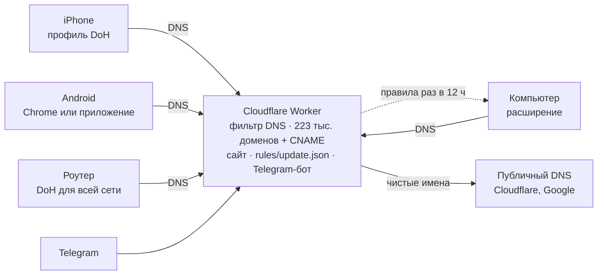

# Свой блокировщик рекламы за 0 ₽: DNS на Cloudflare Workers, расширение MV3 и честные границы

Я собрал блокировщик рекламы для себя и близких: одна ссылка, на ней кнопка под каждое устройство, сервер — бесплатный Cloudflare Worker. Никакой регистрации, никакой карты, никакой «одной программы для всех ОС» — потому что такой честно не бывает.

Что получилось:

- **iPhone** — профиль DNS-over-HTTPS: скачал, ввёл код-пароль, готово. Работает во всех приложениях, включая Chrome.
- **Android** — «Безопасный DNS» в Chrome за минуту, «Частный DNS» (если есть свой VPS с DoT) или маленькое приложение с локальным VPN только для DNS.
- **Компьютер** — расширение Manifest V3 для Chrome-семейства и Firefox: EasyList, RU AdList, EasyPrivacy, антиадблок-список и свои правила, которые обновляются с сервера каждые 12 часов без переустановки.
- **Роутер** — DoH на роутере, и в домашней сети ставить ничего не надо.

Чтобы делиться было проще, есть Telegram-бот: `/start` даёт те же кнопки, присылает расширение файлом, а через `@бот` ссылку можно кинуть в любой чат.

Сайт: https://chisto.flownote.cc · код: этот репозиторий.

## Почему не одна программа и как устроена система

Один бинарник на iOS, Android, Windows, macOS и Linux собрать нельзя: у каждой платформы свой разрешённый способ вмешаться в сеть. Общий знаменатель — DNS, а поверх него в браузере работает расширение.

Устройство спрашивает у нашего сервера, где находится `ads.example.net`. Если домен в списке — отвечаем `0.0.0.0`, и баннер просто не загружается. Иначе пересылаем вопрос публичному резолверу. Трафик сайтов через сервер не идёт — только имена.



У DNS есть предел: он видит только домен. Рекламу с того же домена, что и сайт (`site.ru/ads/banner.js`), он не отличит от контента. Здесь работает расширение: режет по пути и типу файла и прячет пустые места CSS-правилами.

| | Cloudflare Worker | VPS + AdGuard Home |
| --- | --- | --- |
| Цена | 0 ₽, без карты | VPS + домен |
| DoH (iPhone, Chrome, Windows) | да | да |
| DoT (Android «Частный DNS») | нет | да |
| Обновление списков | при деплое | само, раз в сутки |
| Сколько людей | ~10–20 телефонов (100 000 запросов/сутки) | сотни |

На VPS всё поднимается `docker compose up -d`: AdGuard Home делает DNS, Caddy — сертификат Let's Encrypt, сайт и прокси для DoH. Панель AdGuard Home в интернет не торчит: порт 3000 слушает только 127.0.0.1, заход — через SSH-туннель. Публичный 53-й порт тоже закрыт, чтобы сервер не стал открытым резолвером для DDoS-усиления.

## DNS-фильтр на Cloudflare Workers за 0 ₽

Worker отдаёт сайт с кнопками (Static Assets) и отвечает на DoH-запросы по адресу `/dns-query`. Список — AdGuard DNS filter и StevenBlack hosts плюс свои правила: после схлопывания поддоменов около 223 тысяч доменов. Вшиваем их прямо в бандл: 1,7 МБ в gzip при лимите бесплатного тарифа 3 МБ.

Почему не KV: на бесплатном тарифе у запроса 10 мс CPU, а разобрать 5 МБ текста в каждом холодном запуске дорого. JSON из бандла разбирается один раз при старте изолята, дальше проверка — несколько обращений к `Set`:

```js
import LIST from './blocklist.json';
const BLOCK = new Set(LIST.block);
const ALLOW = new Set(LIST.allow);

// ads.tracker.example.com → проверяем сам домен и всех родителей
function isBlocked(name) {
  let d = name;
  for (;;) {
    if (ALLOW.has(d)) return false;
    if (BLOCK.has(d)) return true;
    const i = d.indexOf('.');
    if (i < 0) return false;
    d = d.slice(i + 1);
  }
}
```

Заблокированный ответ собираем вручную: копируем заголовок и вопрос, ставим флаг QR, добавляем одну запись `0.0.0.0` для A или `::` для AAAA. На HTTPS-записи (тип 65) — пустой ответ, иначе браузер пойдёт по подсказке в обход. Остальное пересылаем `POST`-ом в `cloudflare-dns.com`, запасной — `dns.google`.

### CNAME-маскировка

Трекеры давно прячутся под поддоменом самого сайта: `stat.site.ru` → CNAME → `site.tracker.net`. Для браузера это «свой» домен, и список по имени его не поймает. Поэтому Worker разбирает ответ апстрима и проверяет каждую CNAME-цель (с учётом сжатия имён в DNS):

```js
const info = answerInfo(answer);           // CNAME-цели и минимальный TTL
if (info.cnames.some(isBlocked)) return reply(blockedAnswer(query, question));
return reply(answer, info.minTtl);
```

На живых данных: `smetrics.ford.com` уходит CNAME-ом в `ford.com.ssl.sc.omtrdc.net` (Adobe Analytics), `f7ds.liberation.fr` — в `liberation.eulerian.net`. Оба получают `0.0.0.0`. Честности ради: эти два уже есть в AdGuard DNS filter по имени, а CNAME-проверка ловит новые поддомены того же приёма до того, как их добавят в список.

### Общие CDN не трогаем

Есть домены, которые отдают и сайт, и рекламу: `googlevideo.com`, `yastatic.net`, `cloudfront.net`. Заблокируешь в DNS — сломаешь полинтернета. Их список лежит в `filters/shared-cdn.txt`, и сборка не пускает такие домены в DNS-список, даже если они пришли из чужого списка. Резать их можно только в расширении — по пути и типу файла.

Лимиты бесплатного тарифа: 100 000 запросов в сутки — это примерно 10–20 активных телефонов. DoT (порт 853) на Workers не поднять, поэтому «Частный DNS» на Android в этом варианте не работает — сайт этот способ просто не показывает.

## Расширение: как уместить 130 тысяч правил в лимиты MV3

В Manifest V3 расширение больше не смотрит на каждый запрос само. Оно отдаёт браузеру правила `declarativeNetRequest`, а браузер применяет их сам. Отсюда лимиты Chrome:

- 30 000 гарантированных **статических** правил (из них regex — не больше 1 000);
- 30 000 **динамических** «безопасных» правил (block/allow) с Chrome 121, из них перенаправлений — до 5 000.

А сетевых правил в списках вместе около 130 тысяч. Все не влезут, поэтому сборка раскладывает их в два яруса:

1. **Статика (внутри расширения).** Свои правила и антиадблок-список — целиком. Остаток делим между EasyList, RU AdList, русским фильтром AdGuard и EasyPrivacy. Внутри списка сначала берём правила без привязки к сайту — они полезны везде.
2. **Динамика (с сервера).** Что не влезло в статику, уходит в `rules/update.json`. Расширение скачивает его раз в 12 часов и ставит через `updateDynamicRules`. Порядок важен: в Firefox влезает около 5 000, поэтому сначала идут свои правила, потом русские списки, потом остальное.

Итого в Chrome работает около 58 500 сетевых правил вместо 30 000. Это и есть ответ на «реклама придумывает новое»: новое правило ложится в `custom.txt`, и через 12 часов оно у всех — без новой версии расширения и ревью в магазине.

С сервера приходит только JSON с правилами — данные, а не код. Chrome Web Store запрещает удалённый код, и нам он не нужен. В запросе за обновлением нет ни истории, ни адресов страниц, ни cookies (`credentials: 'omit'`).

Откат тоже работает через сервер. В `update.json` есть поле `replacesStatic: ["custom"]`: получив свежую копию своих правил, расширение выключает встроенную. Удалили правило, которое ломало сайт, — оно исчезает у всех, а не живёт до следующего релиза.

### Косметика

Пустые плашки после блокировки, баннеры с того же домена, оверлеи «отключите адблок» прячем CSS. Внедряем его не `<style>` в страницу, а через `scripting.insertCSS` с `origin: 'USER'`: такой стиль сайт не видит в DOM и не может перебить своим `!important`. Каждый селектор — отдельное CSS-правило: один битый селектор в списке через запятую убивает всё правило. `:has()` в общих правилах отбрасываем: он тормозит каждую страницу, точечно — можно.

## Один custom.txt → DNS, Chrome, Safari

Свои правила пишутся в одном файле в формате EasyList/uBlock — его можно целиком вставить и в uBlock Origin. Конвертер без зависимостей (`tools/rules.mjs`) раскладывает каждую строку туда, где она имеет смысл:

| Правило | DNS | Chrome / Firefox | Safari |
| --- | --- | --- | --- |
| `\|\|ads.example.com^` | да | `urlFilter` | regex в `url-filter` |
| `@@\|\|good.example.com^` | исключение | `allow` | `ignore-previous-rules` |
| `\|\|site.ru/ads/$script,third-party` | нет | `resourceTypes`, `domainType` | `resource-type`, `load-type` |
| `$domain=site.ru` | нет | `initiatorDomains` | `if-domain` |
| `$redirect=noop.js` | нет | `redirect` на пустышку | нет |
| `@@\|\|bank.example^$document` | нет | `allowAllRequests` | `ignore-previous-rules` для сайта |
| `##.banner`, `site.ru##.promo` | нет | CSS | `css-display-none` |
| `site.ru#$#body{overflow:auto!important}` | нет | CSS | нет |
| `##+js(...)` (скриптлеты) | нет | нет | нет |

В DNS попадают только чистые `||домен^`: пути и типы файлов DNS не видит, и попытка «блокировать хост целиком» ломает сайты. Поэтому в AdGuard Home полные EasyList и EasyPrivacy выключены: их доменная часть уже входит в AdGuard DNS filter.

Грабли, на которые наступаешь при конвертации:

- **Приоритеты DNR.** При равном приоритете `block` бьёт `redirect`, и правило «отдать пустой скрипт» не срабатывает — сайт ломается. Расставляем явно: block 1, redirect 2, allow 3, allowAllRequests 4, `$important` 5, «выключено на этом сайте» 100.
- **Safari компилирует список целиком.** Один невалидный селектор — и не работает ни одно правило. Косметику для Safari берём только из своего файла, из EasyList — только сетевые правила, до лимита 50 000.
- **Регулярки.** Chrome использует RE2: без lookahead и обратных ссылок. Такие правила отбрасываем на сборке, а не узнаём об этом из консоли браузера.
- **Слишком широкие шаблоны.** Правило из трёх символов без привязки к сайту режет полвеба. Конвертер такие не пропускает: если правило ломает сайт, его надо сузить, а не «усилить блокировку».

## Как реклама отвечает блокировщикам

Реклама и блокировщики — гонка, и победить в ней навсегда нельзя. Можно быстро отвечать:

| Приём рекламы | Ответ | Где граница |
| --- | --- | --- |
| Новые рекламные домены каждую неделю | Списки обновляются; расширение забирает правила раз в 12 часов | Между появлением домена и правилом проходит время |
| CNAME-маскировка под поддомен сайта | Worker и AdGuard Home проверяют всю цепочку CNAME | Трекер на сервере самого сайта DNS не видит |
| Реклама с домена самого сайта | Расширение режет по пути и типу: `\|\|site.ru/ads/$script` | DNS здесь бессилен |
| Случайные имена классов (`.x7f3a`) | Правила по атрибутам и структуре: `[data-ad-slot]`, `div[id^="yandex_rtb_"]` | Нужны правила под конкретный сайт |
| Приманка `ads.js` + оверлей «отключите адблок» | Исключение для приманки, скрытие оверлея, возврат прокрутки CSS | Проверку на сервере сайта сетью и CSS не обойти |
| Сайт ломается без рекламного скрипта | `$redirect=noop.js`: вместо скрипта отдаём пустой файл из расширения | В Safari так нельзя |
| Реклама вшита в видеопоток (SSAI) | — | Сетью и CSS не отделить от видео |

### Стены «отключите блокировщик»

Самая неприятная история: сайт замечает блокировщик и закрывает видео или статью, пока его не отключишь. В большинстве случаев за стеной стоит скрипт-детектор (BlockAdBlock, FuckAdBlock и их клоны) или окно Google Funding Choices. Ответ в три слоя:

1. **Детектор не грузится.** Правила по имени файла: `/blockadblock.js$script`, `/adblock-detector.$script` и подобные. Нет детектора — нет стены.
2. **Список Adblock Warning Removal.** Он обновляется каждый день и содержит точечные правила под конкретные сайты. В расширение он идёт целиком — 2,5 тысячи сетевых правил, до того как делить бюджет между большими списками. Для рунета ещё RU AdList и русский фильтр AdGuard.
3. **Остатки стены прячем CSS** и возвращаем прокрутку: `site.ru#$#body { overflow: auto !important; }`.

На тестовой странице (`site/fixtures/ad.html`) есть фальшивый детектор: без расширения он рисует чёрную стену «отключите блокировщик, чтобы смотреть видео», с расширением файл даже не загружается. Честная граница: если сайт проверяет показ рекламы на своём сервере или стена собрана без отдельного скрипта, сетью и CSS её не снять. Для таких случаев в попапе есть «выключить на этом сайте», а точечное правило в `custom.txt` доедет до всех за 12 часов.

Чего я сознательно не делаю: скриптлеты (подмена функций страницы), модифицированные клиенты YouTube и TikTok, перехват HTTPS своим корневым сертификатом. Это дало бы проценты, но ломает доверие и безопасность устройства за несколько сайтов. Если нужен максимум на компьютере — честно скажу: uBlock Origin в Firefox по-прежнему мощнее, у него нет лимитов MV3.

## iPhone и Android: что разрешают платформы

**iPhone.** Без своего приложения единственный способ — профиль `.mobileconfig` с `com.apple.dnsSettings.managed`. Скрипт собирает его из `.env`, UUID постоянные, чтобы новая версия заменяла старую. Профиль не подписан, и iOS честно пишет «Не подписан»: подписывать чужим сертификатом я не стал. Код-пароль iOS спрашивает всегда — «в один тап» тут не бывает, и на сайте так и написано: 4 касания и код-пароль.

Расширения в Chrome, Яндекс Браузере и Firefox на iPhone поставить нельзя: все они работают на движке Safari, и Apple расширения им не даёт. Зато DNS-профиль работает и в них.

Приложение для iPhone тоже написано: тип DNS Settings через `NEDNSSettingsManager`, а не фейковый VPN, плюс Safari Content Blocker на 50 000 правил. В entitlements только `dns-settings`, privacy manifest — «ничего не собираем». На экране крупно: YouTube, TikTok и Instagram этим не чинятся. Но без аккаунта Apple Developer его не распространить, и обходить ревью я не собираюсь:

| Порог | Значение |
| --- | --- |
| Apple Developer Program | $99 в год |
| Внутренние тестеры TestFlight | до 100, только команда App Store Connect |
| Внешние тестеры | до 10 000, после Beta App Review |
| Публичная ссылка TestFlight | только после ревью |
| Жизнь сборки | 90 дней |

Для обычных людей постоянный канал — App Store, а не вечный TestFlight.

**Android.** Приложение не может само включить «Частный DNS» — это делает только человек в настройках (или владелец телефона через `adb`). Поэтому в приложении локальный `VpnService` с одним маршрутом: в туннель идёт только фальшивый DNS-адрес `10.111.222.1/32`. Приложение разбирает UDP-пакет, отвечает `0.0.0.0` на домен из встроенного списка или пересылает вопрос по DoH. Остальной трафик идёт мимо, как будто приложения нет. Ни device admin, ни accessibility, ни одной зависимости. А если ставить ничего не хочется, в Chrome для Android есть «Безопасный DNS» — вставил адрес, и браузер защищён.

## Приватность, проверка и итог

На сервер уходит только DNS-запрос (имя домена) и раз в 12 часов — запрос файла с правилами. Журналы выключены по умолчанию: в Worker `observability: false` и ни одного `console.log`, в AdGuard Home — `querylog` и `statistics` выключены, IP анонимизируются. Аккаунтов, cookies и аналитики на сайте нет. Честная оговорка: Cloudflare как хостинг обрабатывает запросы по своей политике, это вне нашего кода.

Что проверено руками и скриптами:

| Проверка | Результат |
| --- | --- |
| `ad.doubleclick.net`, `pagead2.googlesyndication.com` через наш DoH | `0.0.0.0`; через публичный DNS — резолвятся |
| `example.com`, `cdnjs.cloudflare.com` | резолвятся |
| Тесты разбора DNS и бота (сжатие имён, CNAME, битые пакеты, кнопки) | 8 из 8 |
| Тестовая страница с рекламой без расширения | «ТЕСТ НЕ ПРОЙДЕН» |
| Та же страница с расширением (Chromium headless) | «ТЕСТ ПРОЙДЕН», 9 из 9 (вместе со стеной детектора) |
| Обновление правил с сервера | 28 999 динамических правил поставлено, встроенный `custom` выключен |
| iOS-проект | собирается под симулятор без подписи |

Что не работает и не будет: реклама в официальных приложениях YouTube, TikTok и Instagram — она идёт с тех же серверов, что и видео. Реклама, вшитая в видеопоток. И сайты, которые проверяют показ рекламы на своём сервере.

Итог: для семьи и друзей хватает бесплатного Worker и одной ссылки. Больше людей — тот же репозиторий поднимается на VPS одной командой `docker compose up -d`.

Код и текст писались вместе с ИИ-ассистентом Claude; все цифры в статье — из реальных прогонов.
